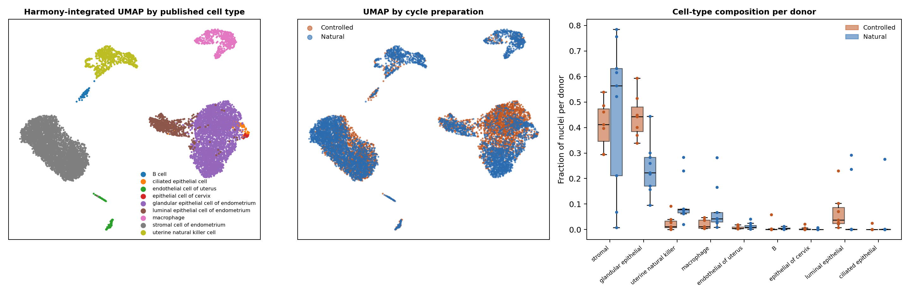
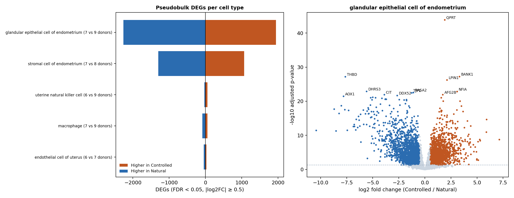
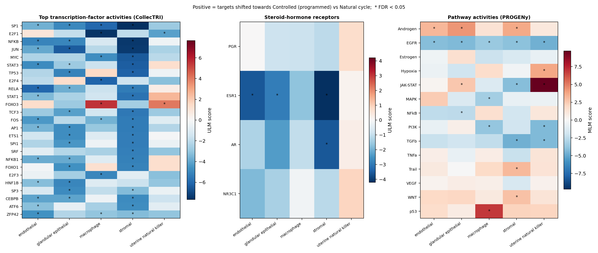
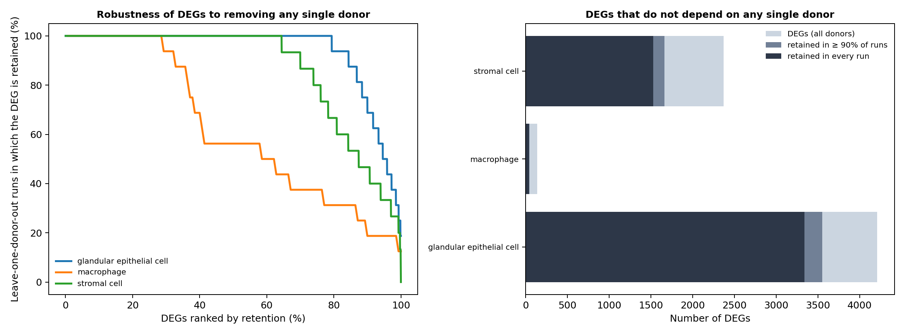

# endometrium-snrna-pseudobulk

[](https://github.com/arjunbioinfo/endometrium-snrna-pseudobulk/actions/workflows/ci.yml)
[](LICENSE)

A reproducible **Snakemake + Python** workflow that takes a public single-nucleus RNA-seq (snRNA-seq) dataset of human endometrium from download to donor-level pseudobulk differential expression per cell type, then asks which transcription factors and signalling pathways explain those changes and whether the results depend on any single donor.

It runs on open data: window-of-implantation endometrium from IVF patients prepared with a **programmed (hormone-replacement) cycle** or a **natural cycle** (Huang *et al.*, *JCI Insight* 2026; 16 donors, 93,064 nuclei, 10x Flex). GitHub Actions runs the full analysis on the real dataset on every push.

## Pipeline

1. **Download, QC and pseudobulk (`01_download_qc_pseudobulk.py`)**: downloads the CC BY 4.0 dataset from CZ CELLxGENE Discover (cached, checksum recorded), keeps raw counts and gene symbols, applies light QC on top of the authors' filtering, tests cell-type composition per donor (Mann–Whitney U, BH), integrates a donor-balanced subsample with Harmony for the UMAP, and sums raw counts per **donor × cell type** using all nuclei.
2. **Pseudobulk differential expression (`02_pseudobulk_de.py`)**: PyDESeq2 per cell type, `~ condition` (programmed vs natural), with **donors as replicates** (cell types need ≥ 4 donors per group and ≥ 20 nuclei per donor). This avoids the inflated false positives of treating nuclei as independent samples.
3. **Transcription-factor and pathway activity (`03_tf_pathway_activity.py`)**: scores each cell type's DESeq2 Wald statistics with [decoupler](https://github.com/saezlab/decoupler-py) against CollecTRI regulons (univariate linear model) and PROGENy pathway footprints (multivariate linear model), with BH correction within each cell type. Steroid-hormone receptors (PGR, ESR1, AR, NR3C1) are shown separately. The networks are fetched once from OmniPath and cached in `data/reference/`.
4. **Leave-one-donor-out robustness (`04_leave_one_donor_out.py`)**: for every cell type with ≥ 100 DEGs, PyDESeq2 is re-run once per donor with that donor removed. A DEG counts as retained when it passes the same thresholds with the same direction.

## Results on the public dataset






* **Composition:** glandular epithelium makes up a larger share of nuclei in programmed cycles (median 44% vs 22% per donor; FDR 0.02); no other cell type differs at FDR < 0.05.
* **Differential expression:** five cell types had enough donors to test. Glandular epithelium (4,207 DEGs) and stroma (2,372 DEGs) change most; stromal genes higher in programmed cycles include *CYP26A1* (log2FC 5.0) and *XDH*. Uterine NK cells, macrophages and endothelium show fewer than 150 DEGs each.
* **Transcription factors:** most significant TF scores are negative, meaning their targets are higher in natural cycles. In stroma these include SP1, NF-κB, JUN, MYC, STAT3 and FOXO1; FOXO1 is also lower in glandular epithelium (FDR 0.0002).
* **Hormone receptors:** ESR1 target activity is lower in programmed cycles in stroma (FDR 0.0007) and glandular epithelium (FDR 0.04), and AR in stroma (FDR 0.007). PGR is not significant in any cell type.
* **Pathways (PROGENy):** EGFR activity is lower in programmed cycles in all five cell types. Stroma shows lower TGF-β and JAK-STAT and higher WNT; uterine NK cells show higher JAK-STAT and hypoxia; macrophages show higher p53.
* **Robustness:** 79% of glandular (3,339 of 4,207) and 64% of stromal (1,528 of 2,372) DEGs stay significant whichever donor is removed, including *CYP26A1*, *XDH*, *AOX1*, *QPRT* and *THBD*. Only 29% of macrophage DEGs (40 of 140) do, so the macrophage signal rests on fewer donors.

### How to read these results

* **Programmed and natural cycles differ in timing as well as hormones.** Differences in endometrial dating between groups, and the shift in epithelial composition, can contribute to the large number of epithelial and stromal DEGs.
* **Pseudobulk with 7 vs 9 donors** has adequate power for strong effects only; DEG counts depend on the FDR and fold-change thresholds in `config/config.yaml`.
* **Activity scores are inferred from prior-knowledge networks**, not measured. CollecTRI regulons mix activating and repressive links, and PROGENy footprints come from other tissues; for example, the PROGENy androgen score points the opposite way to the AR regulon score. Treat them as hypotheses for follow-up.
* **The leave-one-donor-out step re-runs DESeq2 about 50 times** and takes roughly 20 minutes on a laptop.

## Quick start

```bash
pip install -r requirements.txt
pytest -v            # offline unit tests (synthetic toy data)
snakemake --cores 2  # downloads ~760 MB of data on first run
```

Or with Docker:

```bash
docker build -t endometrium-snrna-pseudobulk .
docker run --rm -v "$(pwd)/data:/app/data" -v "$(pwd)/results:/app/results" -v "$(pwd)/figures:/app/figures" endometrium-snrna-pseudobulk
```

## Outputs

* `results/qc_summary.csv`, `celltype_proportions.csv`, `composition_stats.csv` — QC per donor, composition and its tests.
* `results/pseudobulk_counts.csv.gz`, `pseudobulk_samples.csv` — donor × cell-type pseudobulk matrix and sample sheet.
* `results/pseudobulk_de.csv`, `deg_summary.csv` — PyDESeq2 results for every tested cell type.
* `results/tf_activity.csv`, `pathway_activity.csv` — TF (CollecTRI) and pathway (PROGENy) scores, p-values and FDR per cell type.
* `results/lodo_gene_retention.csv`, `lodo_summary.csv` — leave-one-donor-out retention per DEG and per cell type.
* `results/dataset_manifest.json` — dataset URL, licence and SHA-256 checksum.
* `figures/fig1_umap_composition.png`, `fig2_pseudobulk_de.png`, `fig3_tf_pathway_activity.png`, `fig4_leave_one_donor_out.png`.

## Using another dataset

Point `dataset` in `config/config.yaml` at any CELLxGENE-style `.h5ad` with raw counts, and set the donor, condition and cell-type columns and the two condition levels.

## Data and credit

* **snRNA-seq:** Huang D, Flynn E, Davidson BR, *et al.* Programmed cycle-induced endometrial perturbations do not independently influence angiogenic imbalance or hypertensive disorders in pregnancy. *JCI Insight* 2026. [doi:10.1172/jci.insight.202443](https://doi.org/10.1172/jci.insight.202443). Distributed by [CZ CELLxGENE Discover](https://cellxgene.cziscience.com/collections/e80f5450-0a0f-4312-a728-431d50aeb8fe) under CC BY 4.0. The data are downloaded at run time and not stored in this repository.
* **Methods:** Badia-i-Mompel P, *et al.* decoupleR. *Bioinformatics Advances* 2022. [doi:10.1093/bioadv/vbac016](https://doi.org/10.1093/bioadv/vbac016). Müller-Dott S, *et al.* CollecTRI. *Nucleic Acids Research* 2023. [doi:10.1093/nar/gkad841](https://doi.org/10.1093/nar/gkad841). Schubert M, *et al.* PROGENy. *Nature Communications* 2018. [doi:10.1038/s41467-017-02391-6](https://doi.org/10.1038/s41467-017-02391-6). Muzellec B, *et al.* PyDESeq2. *Bioinformatics* 2023. [doi:10.1093/bioinformatics/btad547](https://doi.org/10.1093/bioinformatics/btad547).

This repository is an independent re-analysis and is not affiliated with the dataset authors.

## License

Code: MIT, see [LICENSE](LICENSE). Data keep their original licences.

## Author

**Mallikarjuna Thippana, PhD** — Computational Biologist, Karolinska Institutet  
[Portfolio](https://arjunbioinfo.github.io/) · [ORCID](https://orcid.org/0000-0001-8485-8626) · [Google Scholar](https://scholar.google.com/citations?user=NpLUj68AAAAJ) · [GitHub](https://github.com/arjunbioinfo)
